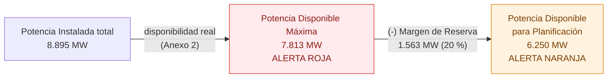
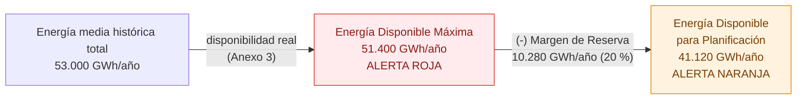
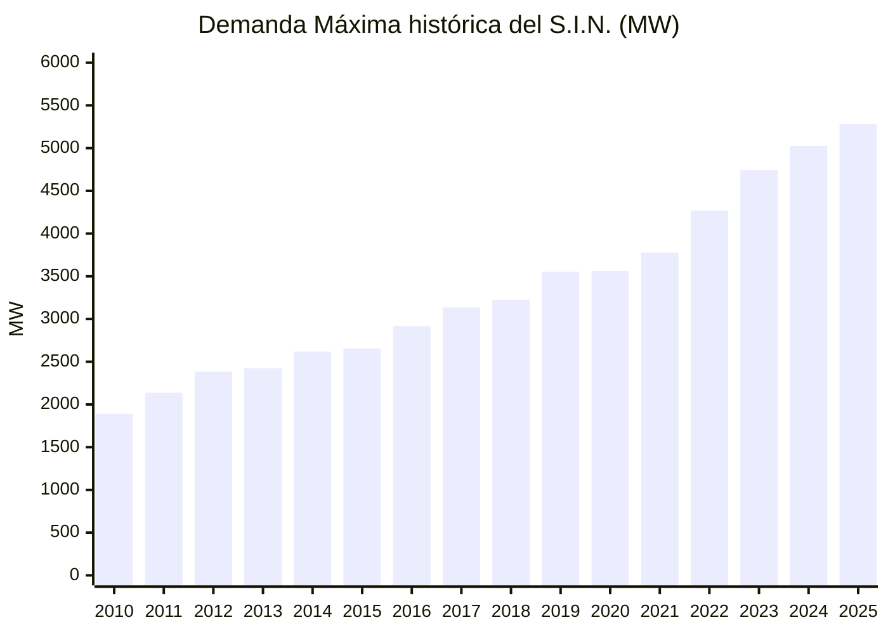
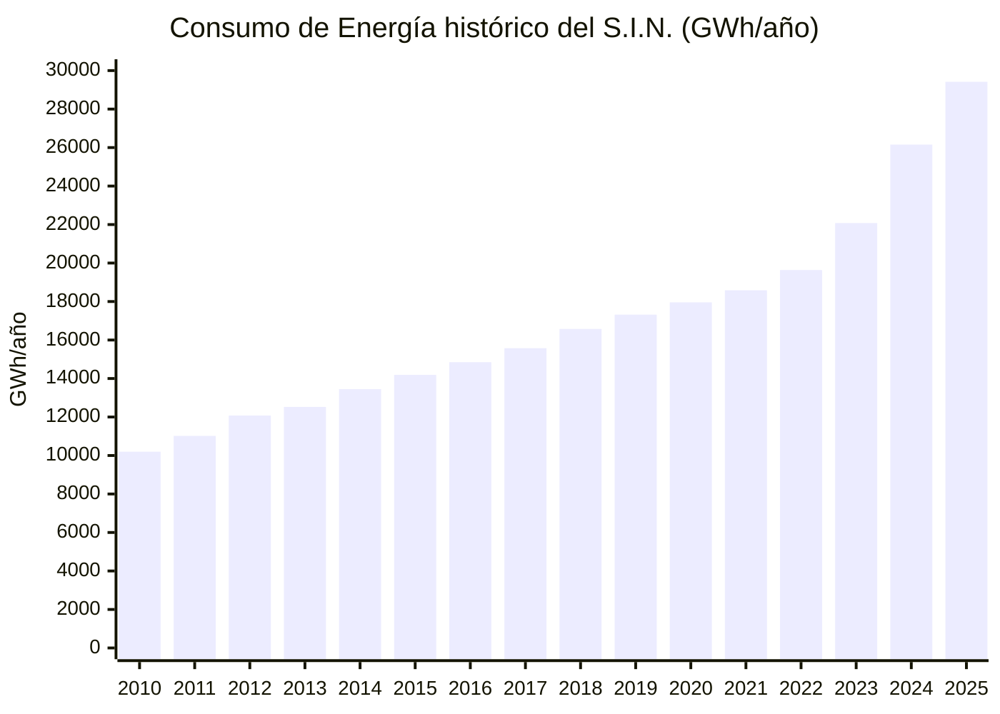
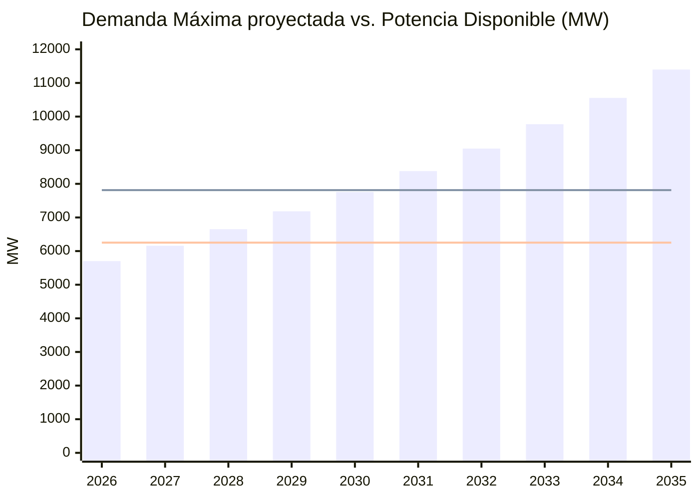
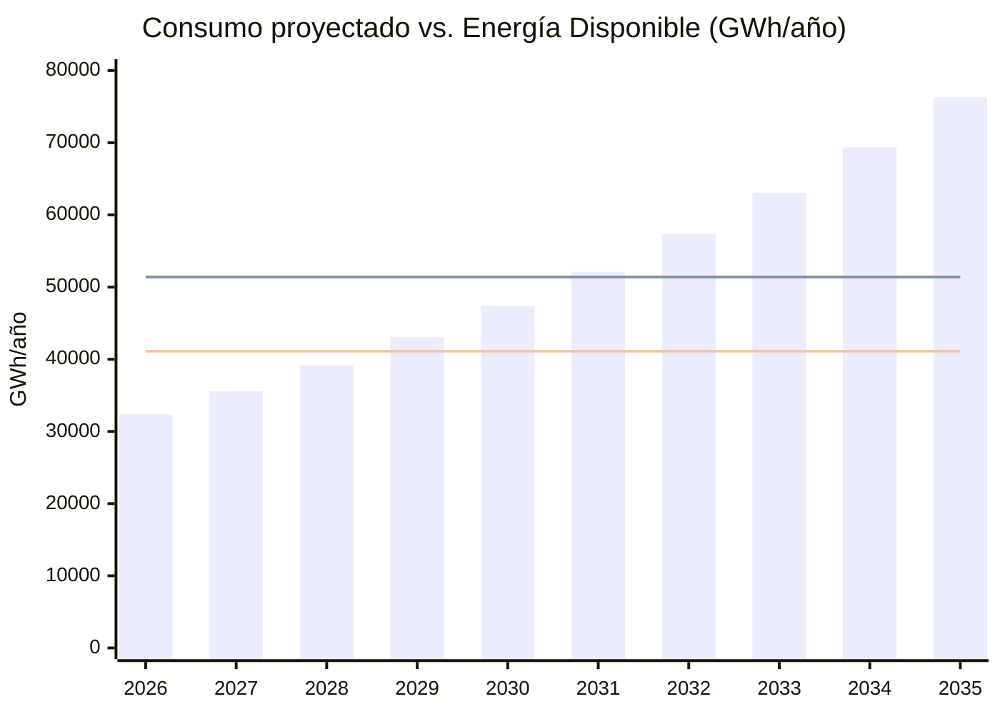
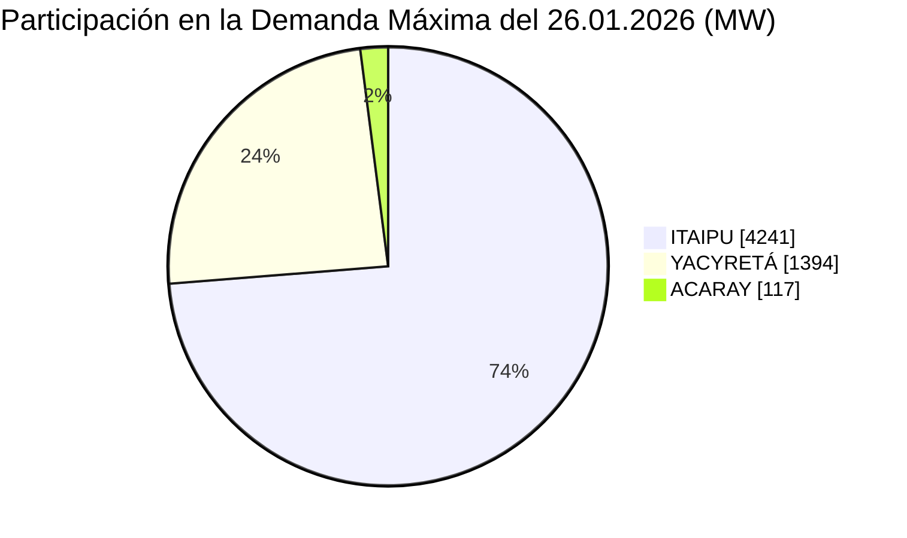
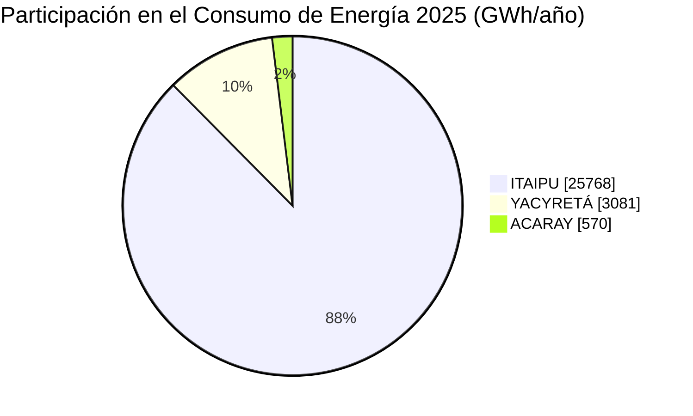
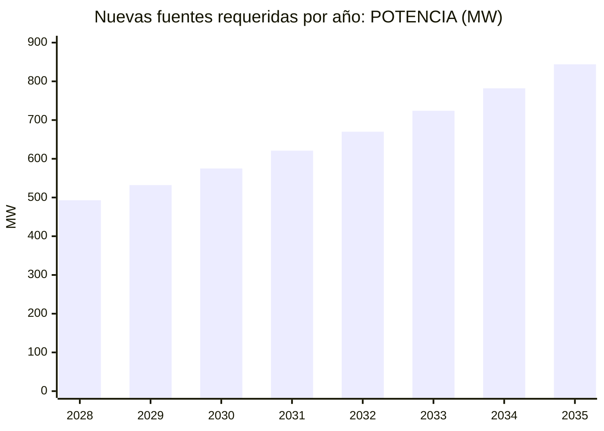
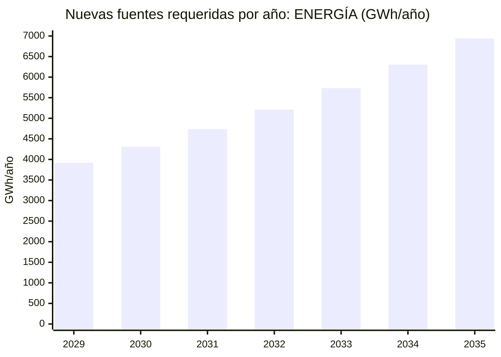

**REQUERIMIENTOS DE GENERACIÓN ELÉCTRICA PARA CUBRIR LA DEMANDA DE POTENCIA Y EL CONSUMO DE ENERGÍA DEL PARAGUAY**

**RIESGO DE CRISIS ENERGÉTICA**  
**Periodo 2026 – 2035**

**PARTE I: FUENTES ACTUALES**  
*29.06.2026*

---

## 1. INTRODUCCIÓN - OBJETO

En documentos anteriores elaborados por el IPPSE, dados a conocer públicamente, se ha realizado un diagnóstico y emitido una opinión sobre los requerimientos y disponibilidades de generación eléctrica para satisfacer la Demanda de Potencia y el Consumo de Energía de los usuarios del servicio de electricidad en el Paraguay en los próximos años.

El IPPSE estimaba entonces, que hacia el final de la década del 2030 llegaría a su límite la capacidad de generación en las Centrales Hidroeléctricas de ITAIPU, YACYRETÁ y ACARAY. Primero sería la POTENCIA disponible, y en breves años más, también la ENERGÍA disponible.

Alertaba sobre la delicada situación, "riesgo de crisis energética" por "déficit de POTENCIA" y por "déficit de ENERGÍA", lo cual significaría limitaciones para atender nuevas conexiones en el servicio de electricidad en caso de que no se dispongan de nuevas fuentes.

Sugeriría en consecuencia, que las autoridades nacionales impulsen las gestiones necesarias para la habilitación de nuevas fuentes de generación para cubrir los requerimientos energéticos futuros, en tiempo oportuno, ya que los tiempos de construcción estarían muy comprometidos.

Transcurrido el tiempo, los registros indican que dichas estimaciones del IPPSE se están confirmando, coincidentes también con las de la [ANDE](https://www.ande.gov.py/) y otras instituciones referentes, por lo cual el "riesgo de crisis energética sigue latente en el periodo 2026-2035" hasta tanto se ejecuten acciones concretas.

Al respecto, el IPPSE presenta ahora un nuevo Informe con una actualización de informaciones sobre la cuestión, analizando la situación, factibilidades, características, costos, cronogramas y nuevas fuentes posibles, a fin de evaluar los diversos factores a tener en cuenta en la planificación de los recursos electro-energéticos para cubrir adecuadamente las necesidades cercanas y futuras del país.

El Informe, titulado "Requerimientos de Generación Eléctrica para cubrir la Demanda de Potencia y el Consumo de Energía del Paraguay - Riesgo de Crisis Energética - Periodo 2026-2035", abarcando el corto y mediano plazo, será elaborado en 3 partes:

*   **Parte I** - Fuentes actuales
*   **Parte II** - [Alternativas de nuevas fuentes](./informe-2-26.md)
*   **Parte III** - Planes de expansión

En esta oportunidad, se presenta a conocimiento y consideración de la ciudadanía la "Parte I - Fuentes actuales", donde se analiza hasta cuando las fuentes de generación actuales pueden atender los requerimientos del sistema eléctrico, exigiendo la incorporación de nuevas fuentes.

---

## 2. FUENTES DE GENERACIÓN ACTUALES

Las fuentes actuales del Sistema Interconectado Nacional (S.I.N.) son las siguientes. En el ANEXO 1, adjunto, se destacan algunas de sus características.

*   Central Hidroeléctrica "[ITAIPU](https://www.itaipu.gov.py/)"
*   Central Hidroeléctrica "[YACYRETÁ](https://eby.gov.py/)"
*   Central Hidroeléctrica "ACARAY"
*   Central Hidroeléctrica "AÑÁ CUÁ" (\*)

> (\*) Este emprendimiento complementario de la CH YACYRETÁ se encuentra en etapa de construcción, previéndose su puesta en servicio para los años 2028-2029. Así, dada la proximidad de su habilitación, en el presente Informe se lo considera como disponible en el corto plazo, dentro del periodo en análisis.

### 2.1. DISPONIBILIDAD DE POTENCIA Y ENERGÍA EN FUENTES ACTUALES

#### 2.1.1. DISPONIBILIDAD DE POTENCIA

Para efectos de planificación y seguridad, es importante señalar los valores de POTENCIA realmente disponibles en las fuentes de generación actuales, que no siempre coinciden con las Potencias instaladas, para evitar una errónea utilización especialmente en épocas de riesgo de crisis, como la que se está analizando.

En el presente análisis se consideran los siguientes valores de las actuales fuentes de generación hidroeléctricas. En los ANEXOS 1 y 2, adjuntos, se amplían detalles para su mejor comprensión.

| Concepto | Potencia | Nivel |
| :--- | ---: | :--- |
| Potencia Instalada total | 8.895 MW | |
| **Potencia Disponible Máxima** | **7.813 MW** | **ALERTA ROJA** |
| Margen de Reserva de Generación | (-) 1.563 MW | |
| **Potencia Disponible para Planificación** | **6.250 MW** | **ALERTA NARANJA** |

#### 2.1.2. DISPONIBILIDAD DE ENERGÍA

Igualmente, para efectos de planificación y seguridad, es importante señalar los valores de ENERGÍA realmente disponibles en las fuentes de generación actuales, que no siempre coinciden con las Energías aseguradas o promedios normales, para evitar una errónea utilización especialmente en épocas de riesgo de crisis, como la que se está analizando.

En el presente análisis se consideran los siguientes valores de las actuales fuentes de generación hidroeléctricas. En los ANEXOS 1 y 3, adjuntos, se amplían detalles para su mejor comprensión.

| Concepto | Energía | Nivel |
| :--- | ---: | :--- |
| Energía media histórica total | 53.000 GWh/año | |
| **Energía Disponible Máxima** | **51.400 GWh/año** | **ALERTA ROJA** |
| Margen de Reserva de Generación | (-) 10.280 GWh/año | |
| **Energía Disponible para Planificación** | **41.120 GWh/año** | **ALERTA NARANJA** |

---

## 3. DEMANDA DE POTENCIA Y CONSUMO DE ENERGÍA

### 3.1. HISTÓRICO

En el cuadro siguiente se muestran los valores registrados en el Sistema Interconectado Nacional (S.I.N.) durante los últimos 15 años, Periodo 2010-2025, suficientemente representativo:

**HISTÓRICO DEMANDA DE POTENCIA Y CONSUMO DE ENERGÍA (Periodo: 2010-2025)**

| Año | Demanda Máxima (MW) | Incremento (MW) | Incremento (%) | Consumo Anual (GWh) | Incremento (GWh) | Incremento (%) | Factor de Carga (%) |
| :--- | ---: | ---: | ---: | ---: | ---: | ---: | ---: |
| **2010** | 1.892 | - | - | 10.198 | - | - | - |
| **2011** | 2.137 | 245 | 12,9 | 11.020 | 822 | 8,1 | 58,9 |
| **2012** | 2.384 | 247 | 11,6 | 12.077 | 1.057 | 9,6 | 57,8 |
| **2013** | 2.425 | 41 | 1,7 | 12.524 | 447 | 3,7 | 59,0 |
| **2014** | 2.619 | 194 | 8,0 | 13.450 | 926 | 7,4 | 58,6 |
| **2015** | 2.656 | 37 | 1,4 | 14.187 | 737 | 5,5 | 61,0 |
| **2016** | 2.917 | 261 | 9,8 | 14.848 | 661 | 4,7 | 58,1 |
| **2017** | 3.135 | 218 | 7,5 | 15.575 | 727 | 4,9 | 56,7 |
| **2018** | 3.226 | 91 | 2,9 | 16.577 | 1.002 | 6,4 | 58,7 |
| **2019** | 3.553 | 327 | 10,1 | 17.319 | 742 | 4,5 | 55,6 |
| **2020** | 3.563 | 10 | 0,3 | 17.956 | 637 | 3,7 | 57,5 |
| **2021** | 3.777 | 214 | 6,0 | 18.583 | 627 | 3,5 | 56,2 |
| **2022** | 4.270 | 493 | 13,1 | 19.635 | 1.052 | 5,7 | 52,5 |
| **2023** | 4.744 | 474 | 11,1 | 22.079 | 2.444 | 12,4 | 53,1 |
| **2024** | 5.027 | 283 | 6,0 | 26.155 | 4.076 | 18,5 | 59,4 |
| **2025** | 5.280 | 253 | 5,0 | 29.419 | 3.264 | 12,5 | 63,6 |

**TASA MEDIA ANUAL DE CRECIMIENTO (%)**

| Periodo | Demanda de Potencia | Consumo de Energía |
| :--- | ---: | ---: |
| **Periodo 2010-2025 (15 años)** | 7,2 | 7,4 |
| **Periodo 2015-2025 (10 años)** | 7,2 | 7,7 |
| **Periodo 2020-2025 (5 años)** | 8,2 | 10,5 |

*Fuente: [ANDE](https://www.ande.gov.py/)*

**Comentarios:** en el periodo considerado, a pesar de la dispersión de valores registrados, tanto la Demanda de Potencia como el Consumo de Energía han tenido un constante crecimiento anual; en los últimos 5 años los promedios han sido superados con un mayor crecimiento.

### 3.2. PROYECCIÓN

Para el Periodo 2026-2035 en análisis, con base en las estadísticas se simula una proyección de la Demanda de Potencia con una tasa de crecimiento del 8% anual, y del Consumo de Energía con una tasa de crecimiento del 10% anual, suponiendo que ambos se mantendrán en el orden de los últimos 5 años, coherente con el crecimiento económico sostenido del país, reflejado en el PIB, el fomento a industrias de mayor porte, la conexión de cargas reprimidas y nuevas cargas, etc., conforme a los planes de desarrollo del Gobierno Nacional.

Mayores detalles sobre los tipos de cargas que influyeron en los registros, así como las perspectivas de cargas especiales futuras, se comentan más adelante.

### 3.3. DEMANDA DE POTENCIA vs. DISPONIBILIDAD ACTUAL

Con base en los puntos 2.1.1. y 3.2. anteriores, se realiza una simulación sobre la cobertura de la futura Demanda de Potencia con la Disponibilidad de Generación actual, sin considerar eventuales nuevas fuentes. Los resultados se muestran en el cuadro siguiente.

**DEMANDA DE POTENCIA vs. DISPONIBILIDAD DE GENERACIÓN ACTUAL (Periodo 2026-2035)**

| Año | Incremento 8% anual (MW) | Demanda Máxima (MW) | Potencia Disponible Máxima (MW) | Excedente (+) Déficit (-) (MW) |
| :--- | ---: | ---: | ---: | ---: |
| **2025** | - | 5.280 | - | - |
| **2026** | 422 | 5.702 | 7.813 | + 2.111 |
| **2027** | 456 | 6.159 | 7.813 | + 1.654 |
| **2028** | 493 | 6.651 | 7.813 | + 1.162 |
| **2029** | 532 | 7.183 | 7.813 | + 630 |
| **2030** | 575 | 7.758 | 7.813 | + 55 |
| **2031** | 621 | 8.379 | 7.813 | **- 566** |
| **2032** | 670 | 9.049 | 7.813 | **- 1.236** |
| **2033** | 724 | 9.773 | 7.813 | **- 1.960** |
| **2034** | 782 | 10.555 | 7.813 | **- 2.742** |
| **2035** | 844 | 11.399 | 7.813 | **- 3.586** |

*Base: Demanda Máxima registrada Año 2025. Fuente: IPPSE*

> **LAPSO CRÍTICO: 2028-2030**
>
> *   **POTENCIA DISPONIBLE PARA PLANIFICACIÓN:** 6.250 MW (ALERTA NARANJA)
> *   **POTENCIA DISPONIBLE MÁXIMA:** 7.813 MW (ALERTA ROJA)

*Barras: Demanda Máxima proyectada (8% anual). Líneas: Potencia Disponible Máxima (7.813 MW, ALERTA ROJA) y Potencia Disponible para Planificación (6.250 MW, ALERTA NARANJA).*

**Comentarios:** se nota que,

*   En el año 2028 se llegaría a la época de riesgo (ALERTA NARANJA), cuando debería comenzar a incorporarse nuevas fuentes de generación para inyectar Potencia al sistema y cubrir el crecimiento de la Demanda, mantener la Reserva Estratégica y evitar consumirla.
*   Hasta el año 2030 alcanzaría la Potencia Disponible Máxima en todas las fuentes de generación actuales (ALERTA ROJA; recursos agotados, sin ninguna reserva).
*   A partir del año 2031 ya se registrarían "déficits de Potencia" para atender la Demanda Máxima del sistema, con aumento progresivo en los años siguientes.

En resumen, la Demanda de Potencia sería cubierta con la disponibilidad de las actuales fuentes de generación solamente hasta el lapso 2028-2030 (lapso crítico), cuando deberían incorporarse nuevas fuentes de generación "para superar el riesgo de una crisis energética por déficit de Potencia" en los años siguientes.

### 3.4. CONSUMO DE ENERGÍA vs. DISPONIBILIDAD ACTUAL

Con base en los puntos 2.1.2. y 3.2. anteriores, se realiza una simulación sobre la cobertura del futuro Consumo de Energía con la Disponibilidad de Generación actual, sin considerar eventuales nuevas fuentes. Los resultados se muestran en el cuadro siguiente.

**CONSUMO DE ENERGÍA vs. DISPONIBILIDAD DE GENERACIÓN ACTUAL (Periodo 2026-2035)**

| Año | Consumo (GWh/año) | Incremento 10% anual (GWh/año) | Energía Disponible Máxima (GWh/año) | Excedente (+) Déficit (-) (GWh/año) |
| :--- | ---: | ---: | ---: | ---: |
| **2025** | 29.419 | - | - | - |
| **2026** | 32.361 | 2.942 | 51.400 | + 19.039 |
| **2027** | 35.597 | 3.236 | 51.400 | + 15.803 |
| **2028** | 39.157 | 3.560 | 51.400 | + 12.243 |
| **2029** | 43.072 | 3.916 | 51.400 | + 8.328 |
| **2030** | 47.380 | 4.307 | 51.400 | + 4.020 |
| **2031** | 52.118 | 4.738 | 51.400 | **- 718** |
| **2032** | 57.329 | 5.212 | 51.400 | **- 5.929** |
| **2033** | 63.062 | 5.733 | 51.400 | **- 11.662** |
| **2034** | 69.368 | 6.306 | 51.400 | **- 17.968** |
| **2035** | 76.305 | 6.937 | 51.400 | **- 24.905** |

*Base: Consumo registrado Año 2025. Fuente: IPPSE*

> **LAPSO CRÍTICO: 2029-2030**
>
> *   **ENERGÍA DISPONIBLE PARA PLANIFICACIÓN:** 41.120 GWh/año (ALERTA NARANJA)
> *   **ENERGÍA DISPONIBLE MÁXIMA:** 51.400 GWh/año (ALERTA ROJA)

*Barras: Consumo de Energía proyectado (10% anual). Líneas: Energía Disponible Máxima (51.400 GWh/año, ALERTA ROJA) y Energía Disponible para Planificación (41.120 GWh/año, ALERTA NARANJA).*

**Comentarios:** se nota que,

*   En el año 2029 se llegaría a la época de riesgo (ALERTA NARANJA), cuando debería comenzar a incorporarse nuevas fuentes de generación para inyectar Energía al sistema y cubrir el crecimiento del Consumo, mantener la Reserva Estratégica y evitar consumirla.
*   Hasta el año 2030 alcanzaría la Energía Disponible Máxima en todas las fuentes de generación actuales (ALERTA ROJA; recursos agotados, sin ninguna reserva).
*   A partir del año 2031 ya se registrarían "déficits de Energía" para atender el Consumo del sistema, con aumento progresivo en los años siguientes.

En resumen, el Consumo de Energía sería cubierto con la disponibilidad en las actuales fuentes de generación solamente hasta el lapso 2029-2030 (lapso crítico), cuando deberían incorporarse nuevas fuentes de generación "para superar el riesgo de una crisis energética por déficit de Energía" en los años siguientes. Tener en cuenta la limitación de Potencia Disponible y su solución en el lapso 2028-2030; sin Potencia no se puede generar Energía.

---

## 4. UTILIZACIÓN DE LAS FUENTES ACTUALES

A fin de ejemplificar el grado de utilización de las fuentes actuales, y su correspondencia con las proyecciones consideradas, se muestran seguidamente algunos valores registrados.

**CON RELACIÓN A LA POTENCIA:** Demanda Máxima del S.I.N., 5.752 MW, ocurrida el 26.01.2026.

**SISTEMA INTERCONECTADO NACIONAL (S.I.N.) - DEMANDA MÁXIMA REGISTRADA** (Fecha: 26.01.2026)

| Fuente | Demanda Máxima registrada (MW) | % Participación | Potencia Disponible de la Fuente (MW) | % Utilización |
| :--- | ---: | ---: | ---: | ---: |
| **ITAIPU** | 4.241 | 74,0 | 6.068 | 70,0 |
| **YACYRETÁ** | 1.394 | 24,0 | 1.400 | 100,0 |
| **ACARAY** | 117 | 2,0 | 210 | 56,0 |
| **TOTAL** | **5.752** | **100,0** | **7.678** | **75,0** |

*Fuente: IPPSE*

**Comentarios:** se nota que,

*   La Demanda Máxima de 5.752 MW registrada en el 2026 (hasta el momento) ya supera a la prevista para este año (5.702 MW) y es 9% mayor que la registrada en el 2025 (5.280 MW). Eso representa que las previsiones del IPPSE sobre el crecimiento son razonables, o subestimadas.
*   Ya estamos consumiendo el 75% de la Potencia Disponible Máxima de nuestras fuentes de generación actuales, y particularmente 70% de ITAIPU y 100% de YACYRETÁ; coherente con las previsiones.

**CON RELACIÓN A LA ENERGÍA:** valores del S.I.N. registrados en el año 2025.

**SISTEMA INTERCONECTADO NACIONAL (S.I.N.) - CONSUMO DE ENERGÍA REGISTRADA** (Fecha: Año 2025)

| Fuente | Consumo total registrado (GWh/año) | % Participación | Energía Disponible de la Fuente (GWh/año) | % Utilización |
| :--- | ---: | ---: | ---: | ---: |
| **ITAIPU** | 25.768 | 87,6 | 40.600 | 64,0 |
| **YACYRETÁ** | 3.081 | 10,5 | 8.900 | 35,0 |
| **ACARAY** | 570 | 1,9 | 1.000 | 57,0 |
| **TOTAL** | **29.419** | **100,0** | **50.500** | **58,0** |

*Fuente: IPPSE*

**Comentarios:** se nota que,

*   Ya estamos consumiendo el 58% de la Energía Disponible Máxima de nuestras fuentes de generación actuales, y particularmente 64% de ITAIPU y 35% de YACYRETÁ; coherente con las previsiones.
    Los valores registrados en las fuentes responden a programación económica de la ANDE, coordinada con las mismas.
*   Según recientes informaciones públicas de la ANDE, el Consumo de Energía acumuló un crecimiento del 21% durante el primer cuatrimestre del 2026, en comparación con el mismo periodo del año anterior, manteniendo su tendencia alcista. Eso representa que las previsiones del IPPSE sobre el crecimiento son razonables, o talvez, también subestimadas.

---

## 5. COMENTARIOS SOBRE LAS CARGAS ESPECIALES

En los últimos años, la "minería digital" (criptominería, legal e ilegal) tuvo marcada influencia en el crecimiento de la carga del S.I.N. (ver cuadro punto 3.1), hecho que se mantendrá durante los años 2026 y 2027 por compromisos contractuales.

Según informaciones de la ANDE, esos Clientes del Grupo de Consumo Intensivo Especial (GCIE) demandan actualmente una Potencia del orden de 1.000 MW, gestionables, siendo sus registros:

| Año | Clientes 23 kV | Clientes 220 kV | Total (Clientes) | Importe facturado (millones USD/año)\* | Energía facturada (GWh/año) | Tarifa media (USD/MWh) |
| :--- | ---: | ---: | ---: | ---: | ---: | ---: |
| **2023** | 36 | 2 | 38 | 24 | 450 | 53,10 |
| **2024** | 45 | 3 | 48 | 106 | 2.307 | 45,95 |
| **2025** | 41 | 7 | 48 | 260 | 5.543 | 46,88 |

*\*No incluye IVA.*

Respecto a la Demanda Máxima de Potencia del S.I.N., puede decirse que no ha sido mayormente influenciada por esas cargas, ya que en los días y horas de mayor Demanda del sistema las mismas han sido reducidas en gran parte, casi totalmente, por exigencia operativa de la ANDE aplicando una condición contractual; eso se refleja en las Demandas máximas registradas en los años 2024 y 2025.

Así, no habrá una reducción significativa de la Demanda Máxima de Potencia del S.I.N. luego del 2027 cuando fenezcan los contratos actuales con esos clientes, y los citados 1.000 MW liberados no se traducirán en una disponibilidad adicional en el sistema para destinarlo a otros usos, tal como algunos referentes suponen.

Respecto al Consumo de Energía del S.I.N., sí ha sido fuertemente influenciada por esas cargas, pero cabe señalar que representó un mejor aprovechamiento de la Energía disponible fuera de punta de la ANDE, reflejándose en un aumento de su Factor de Carga (ver cuadro punto 3.1), y que se tradujo en importantes ingresos económicos que ayudaron a paliar su delicada situación económico-financiera.

Y considerando que la Energía disponible fuera de punta de la ANDE aumentará en los próximos años ante la mayor contratación de Potencia con ITAIPU y la diferencia entre el Factor de Carga de la ANDE (real menor al 60%) y el Factor de Planta de ITAIPU (71-79%), es muy posible que los contratos con dichos clientes continúen por conveniencia y necesidad de la ANDE, bajo nuevas condiciones a ser acordadas; caso contrario, esos excedentes de energía no comercializados se transformarán en costo para la institución.

Así, las proyecciones del IPPSE para la Demanda de Potencia y Consumo de Energía son válidas.

Respecto a "nuevas cargas especiales de alto consumo" que se hicieron públicas recientemente (del orden de 1.000 MW y más), tales como DataCenters y otras de uso electrointensivo, que representarán importantes exigencias al sistema, con valores aún no contemplados en las proyecciones de Potencia y Energía de la ANDE y del IPPSE, habrá que tomar debidos cuidados con sus efectos sobre la disponibilidad de las actuales fuentes de generación, conforme al objeto central del presente Informe del IPPSE.

---

## 6. CONCLUSIONES

*   Las actuales fuentes de generación podrán cubrir la Demanda de Potencia y el Consumo de Energía del S.I.N. solamente hasta el lapso 2028-2030, considerando las hipótesis de crecimiento de 8% y 10% anual, respectivamente.
*   En ese lapso, considerado "crítico", deberían incorporarse nuevas fuentes de generación para superar el "riesgo de una crisis energética por déficit de POTENCIA y de ENERGÍA" en los años siguientes.
*   Así, en el año 2028 debería comenzar la incorporación de nuevas fuentes de generación para inyectar POTENCIA al sistema y cubrir el crecimiento de la Demanda, mantener la Reserva Estratégica y evitar consumirla por seguridad del abastecimiento.
*   Y en el año 2029 debería comenzar la incorporación de nuevas fuentes de generación para inyectar ENERGÍA al sistema y cubrir el crecimiento del Consumo, mantener la Reserva Estratégica y evitar consumirla por seguridad del abastecimiento.

En consecuencia, la capacidad de las nuevas fuentes que deberían ser incorporadas anualmente a partir del año 2028 corresponden a los valores anuales de incremento de POTENCIA y ENERGÍA del S.I.N., y se indican en el cuadro siguiente.

**NUEVAS FUENTES REQUERIDAS (Periodo 2028-2035)**

| Año | POTENCIA (MW) | ENERGÍA (GWh/año) |
| :--- | ---: | ---: |
| **2026** | - | - |
| **2027** | - | - |
| **2028** | 493 | - |
| **2029** | 532 | 3.916 |
| **2030** | 575 | 4.307 |
| **2031** | 621 | 4.738 |
| **2032** | 670 | 5.212 |
| **2033** | 724 | 5.733 |
| **2034** | 782 | 6.306 |
| **2035** | 844 | 6.937 |

**Notas importantes:**

*   Cualquier atraso y menor incorporación de capacidad de nuevas fuentes conforme indicado, representará una reducción de la "Reserva Estratégica" con riesgo de la seguridad del abastecimiento, riesgo de crisis energética.
*   Hay que mantener la "Reserva Estratégica" (Margen de Reserva de Generación; Anexos 2 y 3), cualquiera sea el modelo que resulte más adecuado, por seguridad del abastecimiento.
*   Ante mayores tasas de crecimiento de la Demanda de Potencia y del Consumo de Energía que se registren en los próximos años, el lapso crítico y sus consecuencias se adelantarán.
*   En los próximos 10 años, la energía solar, con Plantas Fotovoltaicas y Banco de Baterías de Alta Potencia asociados, se perfila como la alternativa más viable, o la única por el momento, por los plazos de habilitación, para sustentar los grandes requerimientos futuros de generación eléctrica del S.I.N. Costo conjunto de instalación entre 1,0 y 1,5 millones USD/MW, dependiendo de la configuración; Costo Nivelado de la Energía (LCOE) entre 50 y 60 USD/MWh; Plazo: 3 años. Esto se ampliará en un [próximo Informe del IPPSE](./informe-2-26.md).

---

## ANEXO 1: FUENTES DE GENERACIÓN ACTUALES

### 1. CENTRAL HIDROELÉCTRICA "ITAIPU"

| Característica | Valor |
| :--- | :--- |
| Potencia Instalada | 14.000 MW (10 unid. de 700 MW, 50 Hz y 10 unid. de 700 MW, 60 Hz) |
| Potencia Disponible para Contratación (PDC) | 12.135 MW |
| Energía Garantizada (EG) (probabilística) | 75.135 GWh/año |
| Energía media histórica (EMH) (1992-2025) | 84.000 GWh/año |
| Factor de Planta | 71% (considerando EG y PDC); 79% (considerando EMH y PDC) |
| Operación | Central de "base y punta" |
| Tarifa de Potencia (actual) | 19,28 USD/kW.mes |
| Derechos sobre la producción | 50% para cada parte, conforme al Tratado de ITAIPU |

### 2. CENTRAL HIDROELÉCTRICA "YACYRETÁ"

| Característica | Valor |
| :--- | :--- |
| Potencia Instalada | 3.100 MW (20 unid. de 155 MW) |
| Potencia Disponible para Operación (PDO) | 2.800 MW |
| Energía media histórica (EMH) | 20.000 GWh/año |
| Factor de Planta | 82% (considerando EMHT y PDO) |
| Operación | Central de "base y punta" |
| Tarifa de Energía (aplicada) | 28 USD/MWh (a cuenta de mayor valor de Tarifa actual; Abril 2026: 53,85 USD/MWh) |
| Derechos sobre la producción | 50% para cada parte, conforme al Tratado de YACYRETÁ |

### 3. CENTRAL HIDROELÉCTRICA "ACARAY"

| Característica | Valor |
| :--- | :--- |
| Potencia Instalada | 210 MW (2 unid. de 50 MW y 2 unid. de 55 MW) |
| Energía media histórica | 1.000 GWh/año |
| Factor de Planta | 54% |
| Operación | Central de "base y punta" |
| Costo de producción | 10 USD/MWh |

> **Nota importante:** Actualmente solo están operando 2 unidades generadoras, produciendo un máximo de 136 MW, mientras que las otras 2 están paradas para rehabilitación y repotenciación, con cronograma previsto de finalización para el año 2029.

### 4. CENTRAL HIDROELÉCTRICA "AÑÁ CUÁ"

Su principal objetivo es el aprovechamiento hidroeléctrico del caudal ecológico de 1.500 m³/seg que es necesario mantener en el brazo Añá Cuá del Río Paraná en la CH YACYRETÁ, conforme a cumplimiento de compromisos originales asumidos ante Organismos Internacionales de crédito.

| Característica | Valor |
| :--- | :--- |
| Potencia Instalada | 270 MW (3 unid. de 90 MW c/u) |
| Energía de proyecto | 2.000 GWh/año |
| Factor de Planta | 85% |
| Operación | Central de "base" |
| Costo estimado | US\$ 600 millones (2.220 US\$/kW instalado) |
| Financiamiento | [EBY](https://eby.gov.py/) |
| Tarifa a ser aplicada | 28 USD/MWh (a cuenta de mayor valor de Tarifa actual; Abril 2026: 53,85 USD/MWh) |
| Derechos sobre la producción | 50% para cada parte, conforme al Tratado de YACYRETÁ |

---

## ANEXO 2: DISPONIBILIDAD DE POTENCIA EN FUENTES DE GENERACIÓN ACTUALES

| Fuente | Potencia | Ref. |
| :--- | ---: | :---: |
| ITAIPU | 6.068 MW | (1) |
| YACYRETÁ | 1.400 MW | (2) |
| ACARAY | 210 MW | (3) |
| AÑA CUÁ | 135 MW | (4) |
| **Potencia Disponible Máxima** — **ALERTA ROJA** | **7.813 MW** | (5) |
| (-) Margen de Reserva de Generación | 1.563 MW | (6) |
| **Potencia Disponible para Planificación** — **ALERTA NARANJA** | **6.250 MW** | (7) |

**Donde:**

1.  50% de su Potencia Disponible para Contratación (PDC = 12.135 MW). PDC = (Potencia Instalada 20 máq. x 700 MW = 14.000 MW) - (Potencia en Mantenimiento 2 máq. x 700 MW = 1.400 MW) - (Reserva de Potencia Operativa = 425 MW) - (Consumo Propio = 40 MW) = 12.135 MW
2.  50% de su Potencia Disponible para Operación (2.800 MW), sugerida por referentes de la Entidad ante las actuales limitaciones técnicas de los grupos generadores de la Central, hasta tanto se cumpla integralmente el plan de rehabilitación general vigente en ejecución.
3.  Igual a su Potencia Instalada (210 MW; a pesar de sus limitaciones técnicas actuales).
4.  50% de su Potencia Instalada (270 MW).
5.  Potencia Disponible Máxima. Es el límite disponible. Representa una "ALERTA ROJA", recursos totales agotados, sin ninguna reserva en el sistema.
6.  Margen de Reserva de Generación (MRG), utilizado a efectos de planificación como una "Reserva Estratégica" con valor suficiente para cubrir la operación del sistema ante crisis hídricas del río Paraná, condiciones operativas adversas, atrasos en los procesos de incorporación de nuevas fuentes, crecimiento imprevisto de la Demanda, contingencias, incertidumbres, etc., a fin proporcionar un nivel de seguridad al abastecimiento. Se considera un valor mínimo del 20% de la Potencia Disponible Máxima, si bien la práctica internacional recomienda un valor mayor, especialmente para el sistema paraguayo dadas sus características.
7.  Potencia Disponible considerada a efectos de Planificación, que marca el límite del inicio de incorporación necesaria de nuevas fuentes para inyectar POTENCIA al sistema. Representa una "ALERTA NARANJA", previa a la "ALERTA ROJA", para mantener la Reserva Estratégica y evitar consumirla.

**Notas importantes:**

*   La Potencia Instalada en la Central ITAIPU, considerada en la determinación de la contratación y operación, está relacionada además con la Nota Reversal PY-BR N° 20 del 30.10.1978, y con el Acuerdo Tripartito entre Paraguay, Brasil y Argentina del 19.10.1979.
*   ITAIPU está ejecutando un "Plan de Actualización Tecnológica" para modernizar y mantener todo el equipamiento de la Central en plenas condiciones de funcionamiento futuro. Plazo de ejecución previsto: inicio año 2022, culminación 2036 (14 años). Según informaciones oficiales de ITAIPU, en ese plazo no se reducirá la "Disponibilidad de Potencia Disponible para Contratación". De no ser así, el hecho deberá ser considerado seriamente en la planificación del sistema de generación de la ANDE para atender los requerimientos eléctricos del Paraguay en los próximos años.
*   ANDE utiliza mucho la "Potencia Excedente en ITAIPU", que le permite una importante reducción de sus compras. No obstante, esta Potencia, al ser de disponibilidad eventual y aleatoria, no debe ser considerada en la planificación, ya que se requiere seguridad para cubrir los requerimientos energéticos del sistema.

---

## ANEXO 3: DISPONIBILIDAD DE ENERGÍA EN FUENTES DE GENERACIÓN ACTUALES

| Fuente | Energía | Ref. |
| :--- | ---: | :---: |
| ITAIPU | 40.600 GWh/año | (1) |
| YACYRETÁ | 8.900 GWh/año | (2) |
| ACARAY | 900 GWh/año | (3) |
| AÑA CUÁ | 1.000 GWh/año | (4) |
| **Energía Disponible Máxima** — **ALERTA ROJA** | **51.400 GWh/año** | (5) |
| (-) Margen de Reserva de Generación | 10.280 GWh/año | (6) |
| **Energía Disponible para Planificación** — **ALERTA NARANJA** | **41.120 GWh/año** | (7) |

**Donde:**

1.  50% de su generación media correspondiente a los últimos 10 años (81.200 GWh/año), cuando de observó un ciclo de 5 años húmedos (90.380 GWh/año) y 5 años secos (72.018 GWh/año). *(Ver Nota al final)*
2.  50% de su generación media correspondiente a los últimos 10 años (17.800 GWh/año), cuando de observó un ciclo de 5 años húmedos (19.031 GWh/año) y 5 años secos (16.510 GWh/año). *(Ver Nota al final)*
3.  90% de su generación media histórica (1.000 GWh/año).
4.  50% de su generación de proyecto (2.000 GWh/año).
5.  Energía Disponible Máxima. Es el límite disponible. Representa una "ALERTA ROJA", recursos totales agotados, sin ninguna reserva en el sistema.
6.  Margen de Reserva de Generación (MRG), utilizado a efectos de planificación como una "Reserva Estratégica" con valor suficiente para cubrir la operación del sistema ante crisis hídricas del río Paraná, condiciones operativas adversas, atrasos en los procesos de incorporación de nuevas fuentes, crecimiento imprevisto del Consumo, contingencias, incertidumbres, etc., a fin proporcionar un nivel de seguridad al abastecimiento. Se considera un valor mínimo del 20% de la Energía Disponible Máxima, si bien la práctica internacional recomienda un valor mayor, especialmente para el sistema paraguayo dadas sus características.
7.  Energía Disponible considerada a efectos de Planificación, que marca el límite del inicio de incorporación necesaria de nuevas fuentes para inyectar ENERGÍA al sistema. Representa una "ALERTA NARANJA", previa a la "ALERTA ROJA", para mantener la Reserva Estratégica y evitar consumirla.

> **Nota importante:** Por prudencia y seguridad en la planificación, para ITAIPU y YACYRETA se han utilizado como disponibilidad de generación de energía para el Periodo 2026-2035 en análisis, valores equivalentes al promedio registrado en los últimos 10 años, cuando a un ciclo de 5 años húmedos siguió un ciclo de 5 años secos; es decir, se supone que podría registrarse un ciclo similar en los próximos años.
>
> Así, la disponibilidad utilizada es menor a la que se ha registrado exclusivamente en ciclos de buen caudal del río Paraná, o a promedios históricos extendidos, o a valores de proyecto.

---

**Fuentes institucionales:** [ANDE](https://www.ande.gov.py/), [ITAIPU Binacional](https://www.itaipu.gov.py/), [Entidad Binacional Yacyretá (EBY)](https://eby.gov.py/).

**Continúa en:** [Informe Técnico Nº 2/26 - Parte II: Alternativas de nuevas fuentes](./informe-2-26.md).
